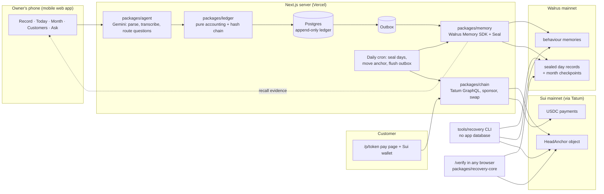

# Trustbook

**The credit book that learns who pays, and keeps your business records in your control.**

Trustbook is an AI bookkeeper for small shops, built first for Nigerian market traders. The owner records sales and credit by typing or speaking, in Pidgin or English. She sees her whole business at a glance and gets credit advice based on how each customer actually pays. She collects debts with WhatsApp reminders and gas-free Sui payments, and she can rebuild her books from Walrus, with proof, even if Trustbook's own database is gone.

Built for **Total Recall — Tatum × Walrus Memory Hackathon**, Track 03 (Consumer Finance Apps).

- **Live app:** https://trustbook-app.vercel.app (demo shop: `/onboarding` → Open the demo shop)
- **Code:** https://github.com/Stella112/trustbook
- **Judges, start here:** [/verify](https://trustbook-app.vercel.app/verify) proves the books in your browser; [/proof](https://trustbook-app.vercel.app/proof) shows live Walrus and Tatum evidence.
- **Demo shop:** "Mama Ngozi Provisions", about six weeks of realistic sample data, labelled **Demo data** everywhere.

## What it does

| | |
|---|---|
| **Record** | "Tunde collect 2 crates egg, 9k, he go pay Friday" → a confirmation card → saved only when the owner taps Confirm. Voice notes go through the same card. |
| **See the business** | Today, This month, a calendar of days, customers sorted by what they owe, CSV export. Totals come from deterministic code; the language model never does arithmetic. |
| **Ask** | "Wetin happen on 14 October?" Questions are answered from ledger queries; dates are resolved in code, in the shop's timezone. |
| **Credit advice that learns** | Each customer has a trust label with its evidence ("Paid 0 of 6 on time · usually 5 days late · 4 promises broken"). Advice quotes memories recalled from Walrus Memory. |
| **Get paid** | Signed pay links and QR codes, WhatsApp reminders sent from the owner's own phone, and Sui payments in USDC, or in any token swapped to USDC in the same payment. The shop sponsors the gas. Every payment is verified through Tatum before it is recorded. |
| **Provable recovery** | Every closed day is sealed to Walrus and chained by hash, and the newest day is anchored on Sui. A standalone tool rebuilds the books and proves they are complete, unchanged and reconciled. |

## How Trustbook uses Walrus Memory

Two kinds of storage, kept apart on purpose:

| Store | Holds | Why |
|---|---|---|
| Postgres | Every entry, exact, append-only | Fast, exact totals |
| Walrus Memory, `trustbook:<shop>:behaviour:<YYYY-MM>` | One memory per credit, payment (days early or late), promise made, kept or broken, label change and monthly lesson | Semantic recall drives advice: the learning loop |
| Walrus, `trustbook:<shop>:ledger:<YYYY-MM>` | Weekly batches of sealed day records, plus a checkpoint per month | A durable, restorable copy of the books |

- **The learning loop.** Before credit advice, Trustbook calls `recall` for that customer across the last three months, filters to the customer, and quotes up to three memories (warning signs first). The **numbers** in the advice always come from the ledger; the **evidence** comes from memory. When behaviour changes, new memories appear and the advice changes with them.
- **Confirmed writes only.** Every write goes through an outbox (`pending → submitted → confirmed | failed`) with retries and dedupe keys. A memory counts only once Walrus returns a blob ID. **47 behaviour memories are confirmed on mainnet**, all listed with blob IDs on `/proof`.
- **Ledger records are sealed to Walrus's open Seal key servers** (threshold 1 of 2). They can be read back from a public Walrus aggregator with only the account's delegate key: no relayer, no API key, no embedding provider. **11 sealed ledger blobs** (42 days in 9 batches, plus 2 month checkpoints) are on mainnet.
- **Recovery** uses `restore` to rebuild the behaviour index and `recall` to export every memory with its blob ID, and lists ledger blobs per month namespace. Namespaces are per month so each stays well under the 100-blob restore cap.

## How Trustbook uses Tatum

All Sui reads and writes go through Tatum's Sui mainnet GraphQL gateway (`packages/chain` is the only module that calls it):

- the latest checkpoint and the Sui head anchor on `/proof` and `/verify`;
- **payment verification**: the transaction by digest, its status, and the balance change that credits the shop with at least the quoted USDC;
- building, simulating and executing sponsored payments, anchor creation and updates, coin balances and metadata for the token picker, and the AnchorCap lookup after a wipe;
- the swap router (Aftermath) is wired to Tatum's client, so even it never talks to another Sui node;
- **the USDC → NGN rate** comes from Tatum's data API.

Tatum's free tier rate-limits (we saw HTTP 429), so reads are batched (one Seal key request for all records) and retried with backoff.

## Architecture



## Provable recovery (the headline feature)

"Restore" means the books were copied back. **Provable** recovery also proves three things, and prints the proof:

1. **Nothing was changed.** Every day record matches its SHA-256 fingerprint.
2. **Nothing is missing.** The chain of days is unbroken from the first day to the newest, and the newest matches the anchor published on Sui. A hash chain alone cannot notice that the newest days were dropped; the Sui anchor can.
3. **The numbers add up.** Totals rebuilt from raw entries equal the sealed month checkpoints, to the kobo.

A real run on mainnet data, with no access to the app database:

```
TRUSTBOOK RECOVERY REPORT — Mama Ngozi Provisions — run 2026-11-06T12:29:58.505Z
Records found ....... 42 day records in 9 Walrus blobs, 2 monthly checkpoints PASS
Anchor (Sui) ........ last day 2026-11-05, 42 days, tx 98tq4P7h1C7MmvisEdf2PS6RbLC66VCujPe2kQyThNd7 PASS
Fingerprints ........ 42/42 day records match, 2/2 checkpoints match     PASS
Chain ............... unbroken GENESIS → 2026-11-05                      PASS
Complete vs anchor .. 42 = 42, head hash matches                         PASS
Totals .............. 2026-09, 2026-10 match sealed checkpoints (0 kobo diff) PASS
Balances ............ 6 customers, ₦73,450 owed at 2026-10 close, all match PASS
Behaviour memory .... 47/47 memories restored                            PASS
RESULT: BOOKS COMPLETE AND UNCHANGED
```

- **Tamper tests**: an edited entry fails *Fingerprints* naming the day; a deleted middle day fails *Chain* naming the gap; a dropped newest day fails *Complete vs anchor*; a re-sealed wrong total fails *Totals* with the kobo difference. These run as unit tests and live on `/verify` ("Try tampering", on an in-memory copy only).
- **Learning survives the wipe**: `apps/web/scripts/rehearse-recovery.ts` records every customer's advice, wipes a separate rehearsal database, recovers from Walrus + Sui, imports, asks again and prints BEFORE and AFTER side by side. Result on 6 Nov: identical labels, numbers and cited memories for all 8 customers.
- The `/verify` page and the CLI use the same pure package, `packages/recovery-core`, so they cannot disagree.

## Run it yourself

Requirements: Node 22+, pnpm 10, a free Postgres (Supabase or Neon), and free keys for Tatum, Gemini (Google AI Studio) and Walrus Memory (memory.walrus.xyz).

```bash
pnpm install
cp .env.example .env          # fill in your own values; never commit .env
cd apps/web
pnpm db:migrate
pnpm seed:demo -- --write     # the demo shop (labelled Demo)
pnpm dev                      # http://localhost:3000
```

Useful scripts (run from `apps/web`):

| Command | What it does |
|---|---|
| `npx tsx scripts/seal-shop.ts` | Seal closed days to Walrus and move the Sui anchor (the daily cron does this on Vercel) |
| `npx tsx scripts/rehearse-recovery.ts` | Wipe a separate rehearsal database, recover, import, compare advice |
| `npx tsx scripts/import-recovery.ts <dir> --database-url <url>` | Fill an empty database from a recovery |

Recovery tool, which never touches the app database:

```bash
cd tools/recovery
npx tsx src/cli.ts --shop demo-mama-ngozi --anchor <HeadAnchor object id> --env ../../.env --out ./recovered
```

On Vercel, set Root Directory to `apps/web`, add the variables from `.env.example` (including `CRON_SECRET` and `APP_URL`), and the two daily jobs in `apps/web/vercel.json` run by themselves.

## Repository layout

```
apps/web                 Next.js app (App Router, TypeScript strict, Tailwind)
packages/ledger          pure accounting, trust labels, hash chain, CSV — no I/O
packages/agent           the only module that calls Gemini
packages/memory          the only module that calls Walrus Memory (+ Seal)
packages/chain           the only module that calls Tatum / Sui (+ swap router)
packages/recovery-core   pure verification shared by the CLI and /verify
packages/move/anchor     Move package: one HeadAnchor per shop
tools/recovery           standalone recovery CLI
docs/                    VERIFIED.md (what was checked live), gate reports, BLOG.md, DEMO.md
```

Money is integers only: kobo for naira, micro-units for USDC. The ledger is append-only; corrections are new entries. 107 unit tests (`pnpm test`).

## Honest limitations

- **The hosted relayer sees plaintext** while it embeds behaviour memories. Only demo data is stored for the hackathon; production would use client-side encryption.
- **Walrus storage expires.** The demo's records are stored until about 4 June 2027 (shown in the app as "Books secured until"). Renewal needs the account owner's wallet and WAL; the app warns 30 days ahead but does not renew.
- **Today is sealed tonight.** Days are sealed after they close (daily cron, 00:15–01:15 Lagos), so today's entries exist only in the database until then.
- **Finding the ledger blobs uses the relayer's listing.** If the relayer is down, the recovery tool accepts the blob IDs (listed on `/proof`); reading the blobs never needs the relayer.
- **Ledger blobs are stored with a random vector instead of an embedding.** The relayer accepts this, but it is undocumented and could change.
- **Gemini's free tier allows about 20 requests a day per model.** Trustbook falls back to other free models when one runs out.
- **Trust labels are per shop and explainable, not a credit score.**
- **Pay with any token** is tested by simulation through Tatum; the swap route is chosen by the Aftermath router.
- **Not built:** Sign in with Google (zkLogin on mainnet needs a paid Enoki plan or a 16-core prover), naira bank transfers, the WhatsApp Business API agent, and voice calls.
- **The demo shop receives payments at the sponsor wallet**, so test payments come back to it. A real shop sets its own address at onboarding.
